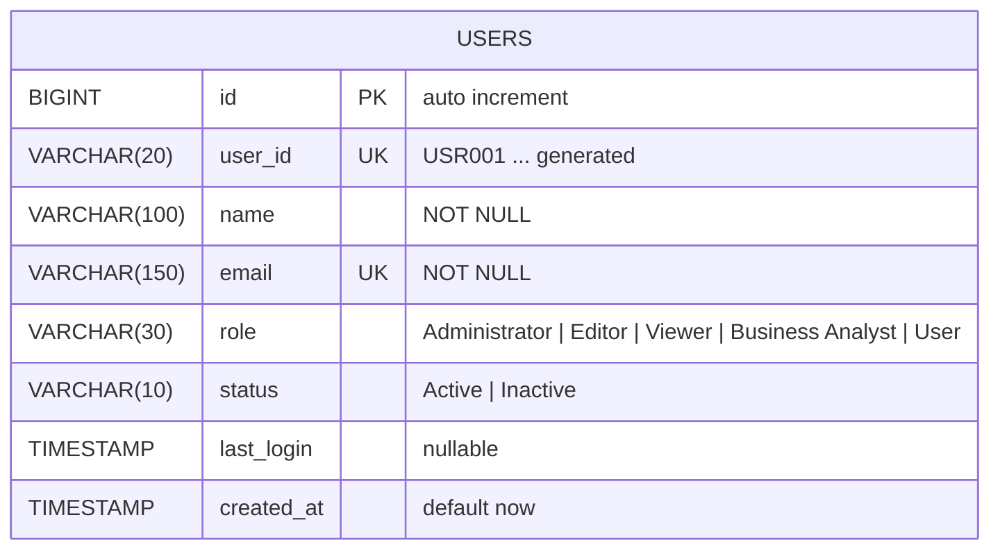

# edabip-dheepanraj-api

**EDABIP – Enterprise Data Analytics & Business Intelligence Platform**
Module: **Users – User Management API** (Dheepanraj)

REST API to list (pagination + search), get, add, edit and delete users, plus user stats
(Total, Active, Inactive, New This Month). Built with **Java 17, Spring Boot 3.3, JDBC (JdbcTemplate) and SQL** – no JPA/Hibernate.

## Tech stack
| Area | Choice |
|---|---|
| Language / framework | Java 17+, Spring Boot 3.3.4 |
| Data access | Spring JDBC (`JdbcTemplate`) |
| Database | H2 in-memory (default, zero setup) **or** MySQL 8 (`mysql` profile) |
| Validation | Jakarta Bean Validation |
| Docs | springdoc-openapi (Swagger UI) + Postman collection |
| Tests | JUnit 5 + MockMvc integration tests |

> Use **JDK 17 or 21** to run/build (very new JDKs may not be supported by this Spring Boot version).

## Setup

### Option A – run with H2 (default, nothing to install but JDK + Maven)
```bash
git clone https://github.com/<your-username>/edabip-dheepanraj-api.git
cd edabip-dheepanraj-api
mvn spring-boot:run
```
`schema.sql` and `data.sql` run automatically on startup (15 seed users).

* API base URL: `http://localhost:8080/api/v1/users`
* Swagger UI: `http://localhost:8080/swagger-ui.html`
* OpenAPI JSON: `http://localhost:8080/v3/api-docs`
* H2 console: `http://localhost:8080/h2-console` (JDBC URL `jdbc:h2:mem:edabip`, user `sa`, empty password)

### Option B – MySQL
```sql
CREATE DATABASE edabip;
USE edabip;
SOURCE src/main/resources/schema.sql;
SOURCE src/main/resources/data.sql;
```
```bash
export DB_USERNAME=root DB_PASSWORD=<your-password>
mvn spring-boot:run -Dspring-boot.run.profiles=mysql
```

### Run tests
```bash
mvn test
```

## Endpoints
Base path: `/api/v1/users`

| Method | Path | Description | Success |
|---|---|---|---|
| GET | `/` | List users – `search`, `role`, `status`, `page` (1-based, default 1), `size` (1-100, default 10), `sortBy`, `sortDir` | 200 |
| GET | `/stats` | Total / Active / Inactive / New This Month | 200 |
| GET | `/{userId}` | Get one user, e.g. `USR001` | 200 |
| POST | `/` | Add user (id `USRnnn` is generated; status defaults to Active) | 201 |
| PUT | `/{userId}` | Edit user (name, email, role, optional status) | 200 |
| DELETE | `/{userId}` | Delete user | 200 |
| DELETE | `/?ids=USR014,USR015` | Bulk delete (UI checkboxes + Delete) | 200 |

`sortBy`: `userId | name | email | role | status | lastLogin | createdAt` · `sortDir`: `asc | desc`
`search` matches user id, name, email and role (case-insensitive).

### Request body (POST / PUT)
```json
{
  "name": "Priya Raman",
  "email": "priya.raman@example.com",
  "role": "Editor",
  "status": "Active"
}
```
Validation rules: `name` required, 2–100 chars · `email` required, valid format, max 150, unique · `role` required, one of
`Administrator, Editor, Viewer, Business Analyst, User` · `status` optional, `Active` or `Inactive`.

### Response format (all endpoints)
Success:
```json
{
  "success": true,
  "status": 200,
  "message": "Users fetched successfully",
  "data": {
    "content": [
      { "userId": "USR001", "name": "Alice Johnson", "email": "alice@example.com", "role": "Administrator",
        "status": "Active", "lastLogin": "2025-05-12T10:30:00", "createdAt": "2025-01-10T09:00:00" }
    ],
    "page": 1, "size": 10, "totalElements": 15, "totalPages": 2
  },
  "timestamp": "2026-10-08T10:15:30.123"
}
```
Error (validation example):
```json
{
  "success": false,
  "status": 400,
  "message": "Validation failed",
  "errors": { "email": "Email must be a valid email address", "role": "Role must be one of: ..." },
  "timestamp": "2026-10-08T10:15:30.123"
}
```
| Code | When |
|---|---|
| 400 | Validation failure, malformed JSON, bad `page/size/sortBy/sortDir`, bad type |
| 404 | User (or endpoint) not found |
| 405 / 415 | Wrong HTTP method / content type |
| 409 | Email already registered |
| 500 | Unexpected / database error (details are logged, not leaked) |

### Stats response
```json
{ "totalUsers": 15, "activeUsers": 11, "inactiveUsers": 4, "newThisMonth": 4 }
```
"New This Month" counts users whose `created_at` falls in the current calendar month.

## ER diagram

Only one table is needed for this module. `role` is stored as a constrained string; when the Role Management module is
built later it can become a foreign key to a `roles` table.

## Project structure
```
src/main/java/com/edabip/users
├── controller/  UserController            (HTTP layer, Swagger annotations)
├── service/     UserService               (business rules, id generation, stats)
├── repository/  UserRepository            (JDBC / SQL only)
├── model/       User
├── dto/         UserRequest, UserResponse, UserStatsResponse, PageResponse, ApiResponse
├── exception/   GlobalExceptionHandler + custom exceptions
└── config/      OpenApiConfig
src/main/resources  schema.sql, data.sql, application.properties, application-mysql.properties
src/test/java       UserApiIntegrationTest
postman/            EDABIP-Users-API.postman_collection.json
```

## Postman
Import `postman/EDABIP-Users-API.postman_collection.json`. The `baseUrl` variable is `http://localhost:8080/api/v1/users`.
Run the folders in order: **Happy path** (Add User saves the new id into `{{userId}}`), **Error cases**, **Bulk**. Each request has tests.

## Design notes
* SQL is parameterised (`?`); `sortBy` is mapped through a whitelist so it cannot be used for SQL injection.
* Emails are trimmed and stored lower-case; uniqueness is checked in the service and backed by a DB unique constraint.
* Add runs in a transaction: insert → generate `USRnnn` from the row id → read back.
* No Lombok – explicit constructors, getters and setters.

## Daily commit plan
* **Day 1** – `chore: project setup`, `feat: schema and seed data`, `feat: user model, repository, list/get/add endpoints`
* **Day 2** – `feat: edit/delete/bulk delete/stats`, `feat: validation and global exception handler`, `test: MockMvc integration tests`
* **Day 3** – `docs: Swagger/OpenAPI config`, `docs: Postman collection`, `docs: README with ER diagram`
